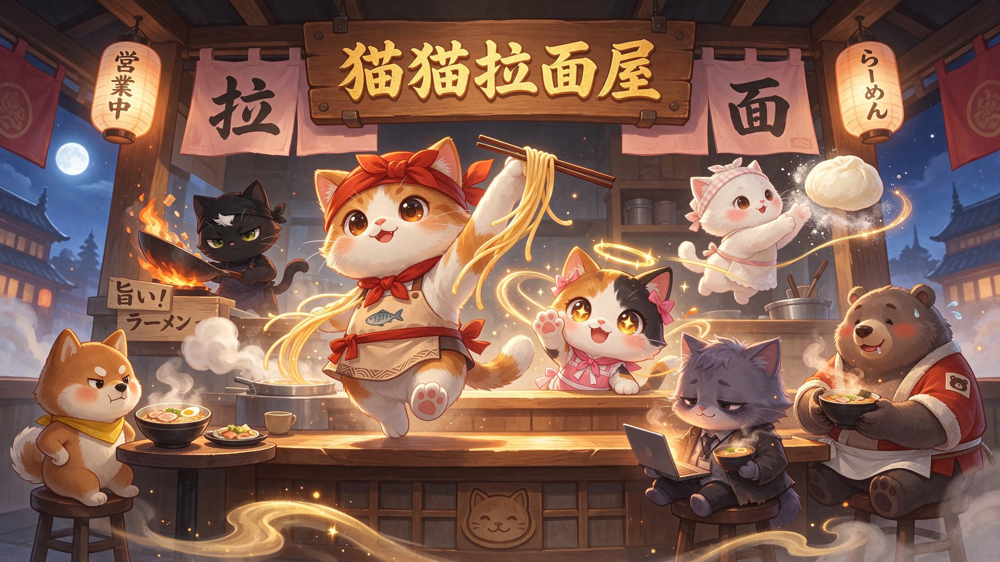

# Cat Ramen Shop · Wok Hei Overload!

**English** | [中文](README.md)



A cozy, cat-themed match-3 browser game about running a tiny ramen shop.

**Match ingredients → fill the bowl → unleash Wok Hei → serve the first bowl to Doucha.**

> **Play online**: <https://mirrorkang.github.io/game-xiaoxiaole-cat/>  
> **Version**: v1.0.0 · Level 1 vertical slice  
> **Download**: <https://github.com/mirrorkang/game-xiaoxiaole-cat/releases/latest>

---

## What is Cat Ramen Shop?

**Cat Ramen Shop** is a browser match-3 game set in a little ramen shop that only opens at dusk. You play as **Atang**, an orange cat chef who inherits the shop and its hundred-year-old broth from Grandma Tang.

Every ingredient you match flies into the order bowl. Fill the bowl, serve a customer, and keep the old broth alive. The first public build is a polished one-level vertical slice: an 8×8 board, a live order bowl, special ingredients, a wok-hei ultimate, a three-star rating, and a forgiving retry system.

- **Genre**: match-3 / cooking / casual
- **Platform**: desktop and mobile web
- **Tech**: vanilla HTML, CSS, JavaScript and WebAudio
- **Level length**: around 2–3 minutes per attempt

## The story

Grandma Tang has gone travelling. She left Atang the shop, the century-old broth, and one note:

> “The fire must not go out. The soup must not go cold. The customer must not go hungry.”

The first customer of the night is **Doucha**, a grumpy Shiba Inu who insists he is not impressed. He still finishes every drop.

## How to play

- **Swap**: drag an ingredient onto an adjacent tile, or tap one tile and then an adjacent one.
- **Match**: line up 3 or more of the same ingredient to clear them. Cleared ingredients fly into the bowl.
- **Fill the order**: Doucha wants:
  - Noodles ×10
  - Eggs ×6
  - Chashu ×4
  - Nori ×6
  - 26 ingredients in total
- **Moves**: 18 moves. A successful swap costs 1 move; special effects and cascades are free.
- **Special ingredients**:
  - 4 in a row → **Cleaver**, clears a full row or column
  - L / T shape → **Firecracker**, explodes a 3×3 area
  - 5 in a row → **Rainbow Soup**, clears one ingredient type
  - Swap two specials → **Full-Wok Stir-Fry**
- **Wok Hei**: matches and cascades charge the wok-hei gauge. When it is full, tap anywhere on the board to use **Wok Hei Overload**.
- **Three stars**:
  - ★ Serve the ramen
  - ★★ Finish with at least 2 moves left
  - ★★★ Use Wok Hei Overload at least once
- **Hints**: after 5 seconds of inactivity, Atang taps a possible move.
- **Rescue**: once per level, add 3 moves with “Cook for Three More Minutes.”
- **Pause / mute**: top-right corner.

## Features

- Responsive desktop and mobile layout.
- 8×8 board, 5 ingredient types, 18 moves, 26-item order.
- Swap, match, cascades, gravity, refill.
- Cleaver, Firecracker, Rainbow Soup and Full-Wok Stir-Fry.
- A live order bowl that fills as ingredients fly in.
- Wok-hei gauge, Wok Hei Overload and an automatic finishing stir-fry.
- Three-star results, retry, one-time +3-move rescue.
- Hints, auto-shuffle, pause, mute, and local best-star saving.
- Serving cutscene, polaroid and level-clear celebration.
- Particles, screen shake, slow motion, sound effects and dynamic music.
- Animated shop: rain window, drifting clouds, moon glow, swaying lantern, steam, floating dust, stove embers, a plant and a handwritten menu.
- Combo banners from 3-chain upward, plus a three-success stamp and streak meter.
- Chinese and English project documentation.

## Characters

- **Atang** — orange cat, shop owner and head chef. Red headband, red neckerchief, fish apron.
- **Doucha** — Shiba Inu, first customer. Grumpy on the outside, hungry on the inside.
- The wider cast — **Bear**, **Dango**, **Momo**, **Mina** and **Huahua** — appears in the character sheet and is planned for future levels.

Character art and the key visual are provided by the project creator.

## Run locally

Open `index.html` directly in Chrome, Edge or Safari.

If your browser is strict about local files:

```bash
python3 -m http.server 8000
```

Then open `http://localhost:8000`.

> Audio starts only after you press “Start Service” (开始营业) for the first time, as required by browser autoplay policies.

## Current scope

This is **Level 1**, not a complete game yet:

- One customer and one level.
- “Level 2” is shown as “Coming Soon.”
- No level map, shop decoration, character progression or leaderboard.

The goal is to make this one bowl feel good first, then decide what to cook next.

## Links

- Live game: <https://mirrorkang.github.io/game-xiaoxiaole-cat/>
- Repository: <https://github.com/mirrorkang/game-xiaoxiaole-cat>
- Latest release: <https://github.com/mirrorkang/game-xiaoxiaole-cat/releases/latest>
- Chinese README: [README.md](README.md)

---

Made with a love for ramen, cats, and tiny satisfying pops.
