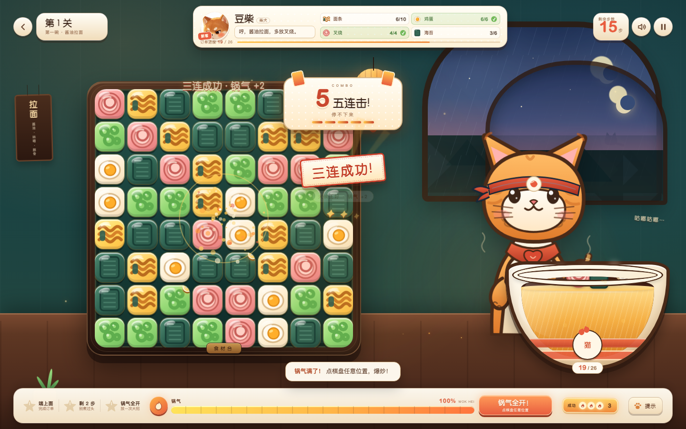

# 猫猫拉面屋 · 第一关

一个可以直接在浏览器里玩的消消乐小游戏。  
**消食材 → 下锅 → 锅气全开 → 把第一碗面端给豆柴。**

> **在线试玩**：<https://mirrorkang.github.io/game-xiaoxiaole-cat/>  
> **版本**：v1.0.0 · 第一关样片




## 小店的故事

汤婆婆出门旅行了。她把一口熬了一百年的老汤，和街角这间小店，一起留给了学徒阿汤。

老汤不能熄火，灯笼不能灭。火一灭，整条街的猫都会觉得今晚少了点什么。

所以，阿汤系上红头巾，开始了他看店的第一晚。第一位客人，是嘴硬心软的柴犬豆柴。

---

## 怎么打开

最简单：**双击 `index.html`**，用 Chrome / Edge / Safari 打开。

如果浏览器对本地文件比较严格，可以在本文件夹打开终端，运行：

```bash
python3 -m http.server 8000
```

然后打开 `http://localhost:8000`。

> 第一次打开时点一下「开始营业」，浏览器才允许播放音乐和音效。

---

## 怎么玩

- **交换**：拖动一颗食材到相邻格子，或者先点一颗、再点相邻的一颗。
- **消除**：3 个及以上同色食材横/竖相连就会消除，食材会飞进碗里。
- **订单**：豆柴要一碗酱油拉面，需要凑齐：
  - 面条 ×10
  - 鸡蛋 ×6
  - 叉烧 ×4
  - 海苔 ×6
  - 共 26 个食材
- **步数**：18 步。消掉食材不消耗额外步数；只有成功交换才消耗 1 步。
- **特殊食材**：
  - 4 连 → 刀光，清一整行/列
  - L / T 形 → 火爆，炸掉 3×3
  - 5 连 → 彩虹汤，清掉一种食材
  - 两个特殊食材交换 → 满锅爆炒
- **锅气**：消除和连锁会攒锅气。满了之后，点棋盘任意位置放大招「锅气全开」。
- **三星**：
  - ★ 把面端给豆柴
  - ★★ 完成时剩 ≥ 2 步
  - ★★★ 本关至少放一次锅气全开
- **提示**：5 秒不操作阿汤会点一步；也可以点「提示」。
- **失败救场**：每关有一次「再煮三分钟 +3 步」。
- **暂停/静音**：右上角。

---

## 已实现的内容

- 标题画面、桌面/手机自适应布局。
- 8×8 棋盘、5 种食材、18 步、26 个食材的订单。
- 交换、消除、连锁、掉落、补位。
- 刀光 / 火爆 / 彩虹汤 / 满锅爆炒。
- 订单碗、食材飞进碗里、汤面进度。
- 锅气槽、锅气全开、自动收官爆炒。
- 三星结算、失败重试、一次 +3 步救场。
- 提示、自动洗牌、暂停、静音、最好成绩保存。
- 上菜小动画、拍立得、第一关通关。
- 粒子、震屏、慢动作、音效和动态背景音乐。
- 动态小店：雨窗、流云、月亮呼吸、灯笼摇摆、蒸汽、浮尘、灶台火星、门口绿植、墙上菜单。
- 声音层次：动态 BGM、环境底噪、交换/订单/上菜/得星/猫猫称赞音效。
- 成功反馈：交换光环、食材飞碗、碗面涟漪、订单打勾与「订单完成」盖章、阿汤称赞气泡、锅气爆燃。
- 连击设计：3 连击起出现大横幅，3/4/5/6 连有不同称号与颜色。
- 三连成功：底栏有「成功」三格火焰；连续三次成功操作会盖下「三连成功！」章，奖励锅气 +2。无效交换会打断连胜。
- 专属音效：连击里程碑、三连成功、订单打勾、上菜、得星都有独立音色。

---

## 角色

- **阿汤**：店长 / 主厨，橘猫，红头巾、红领巾、鱼形围裙。
- **豆柴**：第一关客人，傲娇嘴硬，吃完真香。
- 其他角色（熊大叔、团子、墨墨、咪娜、花花）在角色设定板里，等你解锁后面的关卡。

角色原画由制作人提供。

---

## 文件结构

```text
cat-ramen-match3/
├── index.html          # 游戏入口
├── styles.css          # 界面、棋盘、动画样式
├── game.js             # 游戏逻辑
├── assets/
│   ├── cat-chef.svg    # Q 版阿汤
│   ├── bowl.svg        # 上菜用的拉面碗
│   └── characters/     # 阿汤、豆柴立绘
├── preview-title.png   # 标题页预览
├── preview-game.png    # 游戏画面预览
└── README.md
```

设计与截图源文件保留在本地，不随网页发布。

---

## 当前范围

这是**第一关样片**，不是完整游戏：

- 只有一个客人、一个关卡。
- 通关后「第 2 关」显示为「敬请期待」。
- 没有关卡地图、店铺装修、角色养成、排行榜。

先把它玩爽，再决定下一碗面怎么煮。

---

## 发布信息

- 在线试玩：<https://mirrorkang.github.io/game-xiaoxiaole-cat/>
- 源码仓库：<https://github.com/mirrorkang/game-xiaoxiaole-cat>
- 下载最新版：<https://github.com/mirrorkang/game-xiaoxiaole-cat/releases/latest>
